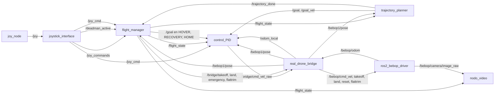
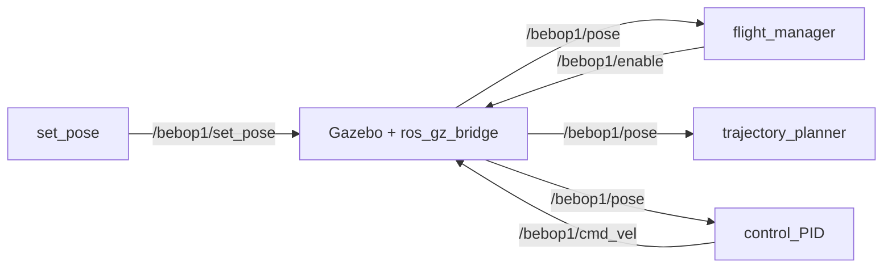
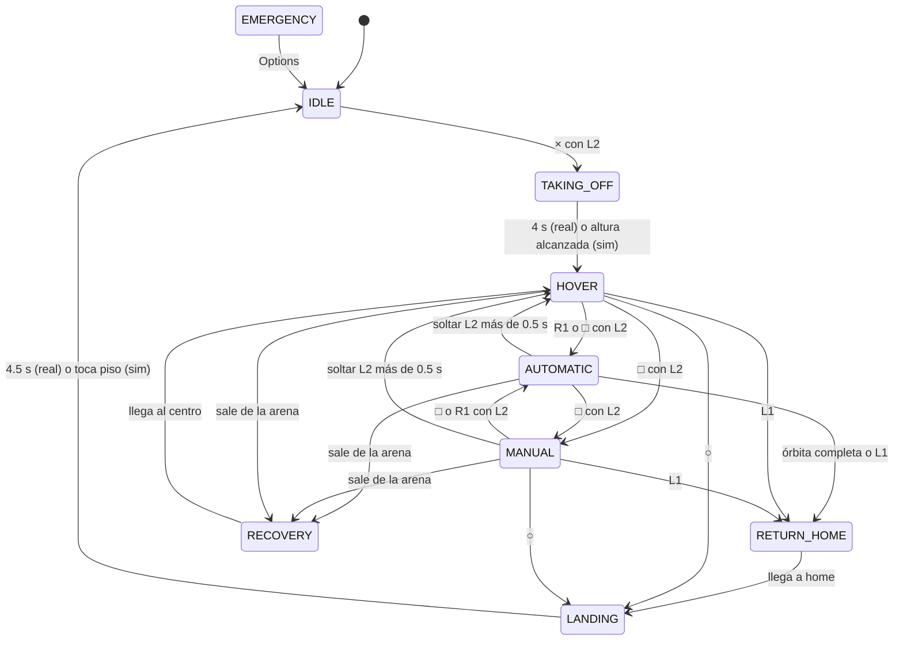

# Documentación del proyecto Vuelo_bebop_v1

Guía completa para quien llega nuevo al proyecto. Explica qué se busca, cómo está organizado el código, cómo fluye la información entre nodos, cómo volar en simulación y con el dron real, y qué limitaciones conocidas hay.

---

## Índice

1. [Objetivo del proyecto](#1-objetivo-del-proyecto)
2. [Estructura del repositorio](#2-estructura-del-repositorio)
3. [Instalación y compilación](#3-instalación-y-compilación)
4. [Arquitectura general](#4-arquitectura-general)
5. [Marcos de referencia y convenciones](#5-marcos-de-referencia-y-convenciones)
6. [Máquina de estados de vuelo](#6-máquina-de-estados-de-vuelo)
7. [Nodos del paquete control_bebop](#7-nodos-del-paquete-control_bebop)
8. [Mando PS5 DualSense](#8-mando-ps5-dualsense)
9. [Configuración y parámetros](#9-configuración-y-parámetros)
10. [Cómo volar](#10-cómo-volar)
11. [Datos: bags, videos y análisis](#11-datos-bags-videos-y-análisis)
12. [Simulación contra dron real](#12-simulación-contra-dron-real)
13. [Dinámica del Bebop y ajuste de ganancias](#13-dinámica-del-bebop-y-ajuste-de-ganancias)
14. [Seguridad](#14-seguridad)
15. [Problemas conocidos y limitaciones](#15-problemas-conocidos-y-limitaciones)
16. [Pruebas](#16-pruebas)
17. [Próximos pasos del proyecto](#17-próximos-pasos-del-proyecto)
18. [Glosario](#18-glosario)

---

## 1. Objetivo del proyecto

El proyecto busca reconstruir en 3D un objeto de interés usando un dron Parrot Bebop 2. El flujo completo tiene cuatro fases:

1. **Primer vuelo.** El dron rodea el objeto en una trayectoria circular, con la cámara siempre apuntando al centro, y graba video.
2. **Reconstrucción.** Con el video se hace una reconstrucción 3D del objeto, por ejemplo por fotogrametría.
3. **NBV (Next Best View).** Se analiza la reconstrucción para encontrar las zonas con poca información y calcular desde dónde convendría verlas.
4. **Segundo vuelo optimizado.** El dron vuela a esas vistas para completar la reconstrucción.

**Estado actual (octubre 2026):** fase 1, vuelo experimental. Este repositorio contiene el sistema de control de vuelo, la trayectoria circular, la grabación de video y la simulación. La reconstrucción y el NBV todavía no están en el repositorio.

---

## 2. Estructura del repositorio

```
Vuelo_bebop_v1/
├── README.md               Portada breve del repositorio
├── DOCUMENTACION.md        Este documento
├── bebop_ros/              Simulación en Gazebo (copia de juliordzcer/bebop_ros)
│   ├── bebop_gz/           Mundo bebop1.sdf, modelo del dron, plugins de Gazebo
│   ├── bebop_demo/         set_pose (pose inicial) y config del puente ROS↔Gazebo
│   ├── bebop_controller/   PID de ejemplo del repo original (no se usa aquí)
│   ├── bebop_bearings/     Control de formación (no se usa aquí)
│   ├── bebop_gui/          GUI Qt del repo original (no se usa aquí)
│   └── bebop_ros_gz/       Metapaquete
└── control_bebop/          ★ Paquete principal de este proyecto (Python, ament_python)
    ├── control_bebop/      Código de los nodos
    ├── launch/             Archivos de arranque
    ├── config/             Parámetros YAML
    ├── scripts/            Herramientas de análisis fuera de ROS
    ├── test/               Pruebas unitarias
    ├── resource/meshes/    Modelos 3D de objetos para Gazebo
    └── bags/               Vuelos grabados (no se suben a git)
```

### Paquetes externos necesarios en el workspace

No están en este repositorio, pero deben estar en `~/ros2_ws/src`:

| Paquete | Origen | Para qué sirve |
|---|---|---|
| `ros2_bebop_driver` | github.com/jeremyfix/ros2_bebop_driver | Driver ROS 2 del Bebop real: comandos, odometría, cámara |
| `ros2_parrot_arsdk` | Dependencia del driver | SDK oficial de Parrot (ARSDK 3.14) compilado |

El driver es de terceros y **no se modifica** en este proyecto. Su autor lo declara versión alfa, con odometría poco probada.

---

## 3. Instalación y compilación

### Entornos usados

El proyecto se usa en dos computadoras:

| Equipo | Sistema | ROS 2 | Gazebo | Launch de simulación |
|---|---|---|---|---|
| Laptop | Ubuntu 22.04 | Humble | Fortress | `sim_flight_humble.launch.py` |
| Escritorio | Ubuntu 24.04 | Jazzy | Harmonic | `main_flight.launch.py` |

### Dependencias de Python

| Biblioteca | Usada por |
|---|---|
| numpy, matplotlib | GUIs, análisis, previsualización |
| opencv (`cv2`), `cv_bridge` | Grabación de video, YOLO |
| PyQt5 | `muestra_odometria_gui` |
| tkinter | `gui_odometria` |
| ultralytics | Detección YOLOv8 (en el entorno virtual `~/rob_env`) |
| rosbags | `datos.py`, `analisis_deriva.py` (entorno `~/env_dron` o `~/rob_env`) |
| casadi | `consumo_energ.py` (borrador) |
| pyyaml | `analisis_deriva.py` |

Varios nodos agregan a mano `~/rob_env/.../site-packages` o `~/env_dron/.../site-packages` a `sys.path`, para encontrar bibliotecas instaladas en esos entornos virtuales.

### Compilar

```bash
cd ~/ros2_ws
source /opt/ros/humble/setup.bash        # o jazzy
colcon build --packages-select control_bebop
# La primera vez, también la simulación y el driver:
colcon build --packages-select bebop_gz bebop_demo ros2_parrot_arsdk ros2_bebop_driver
source install/setup.bash
```

Cada cambio en el código Python o en los YAML requiere volver a compilar `control_bebop`, porque los launches leen los archivos instalados en `install/`, no los de `src/`.

---

## 4. Arquitectura general

El sistema se divide en nodos con una sola responsabilidad cada uno. El **flight_manager** decide en qué estado está el vuelo. El **trajectory_planner** dice a dónde ir. El **control_PID** calcula el comando. El **real_drone_bridge** lo filtra y se lo entrega al driver.

### Vuelo real (`real_flight.launch.py`)



### Simulación (`sim_flight_humble.launch.py` o `main_flight.launch.py`)

En simulación no hay bridge ni driver. Gazebo publica la pose directamente en `/bebop1/pose`, y el PID manda su comando directo a `/bebop1/cmd_vel`.



### Tópicos principales

| Tópico | Tipo | Publica | Contenido |
|---|---|---|---|
| `/flight_state` | Int32 | flight_manager | Estado actual (0 a 8, ver sección 6) |
| `/goal` | Pose | trajectory_planner o flight_manager | Posición y yaw deseados, marco de despegue |
| `/goal_vel` | Twist | trajectory_planner | Velocidad del setpoint, para feedforward |
| `/trajectory_done` | Bool | trajectory_planner | `True` al completar una vuelta |
| `/bebop1/pose` | Pose | bridge (real) o Gazebo (sim) | Posición actual, marco de despegue |
| `/odom_local` | Odometry | bridge | Pose local y velocidad en marco del cuerpo |
| `/bridge/cmd_vel_raw` | Twist | control_PID (real) | Comando normalizado antes de seguridad |
| `/bebop/cmd_vel` | Twist | bridge | Comando final al driver |
| `/bebop/odom` | Odometry | driver | Odometría cruda (Norte, Oeste, Arriba) |
| `/bebop/camera/image_raw` | Image | driver | Video de la cámara del Bebop |
| `/bebop/move_camera` | Vector3 | control_camara, GUIs | Orientación de la cámara digital |
| `/joy` | Joy | joy_node | Lectura cruda del mando |
| `/joy_commands` | Int32 | joystick_interface, control_panel | Botones, como códigos 10 a 19 |
| `/joy_cmd` | Twist | joystick_interface | Sticks escalados, solo con deadman activo |
| `/deadman_active` | Bool | joystick_interface, control_panel | L2 presionado |
| `/bebop1/enable` | Bool | flight_manager | Habilita los motores en Gazebo |

### Frecuencias

| Elemento | Frecuencia |
|---|---|
| Estado enviado por el Bebop (velocidad, actitud) | ~5 Hz |
| `/bebop/odom` publicado por el driver | 15 Hz |
| `control_PID` | 10 Hz |
| `trajectory_planner` y `flight_manager` | 20 Hz |
| Watchdog del bridge hacia el driver | 20 Hz |
| Cámara del driver | ~33 Hz |

---

## 5. Marcos de referencia y convenciones

### Odometría del driver (`/bebop/odom`)

El driver no mide posición. Toma la velocidad que reporta el Bebop, estimada con flujo óptico, sonar y barómetro, y la **integra en el tiempo**. Sus ejes son:

- x = Norte, y = Oeste, z = Arriba.
- yaw = rumbo antihorario medido desde el Norte, según el magnetómetro.
- La velocidad del twist viene en marco del cuerpo.

Como la posición es una suma de velocidades, acumula error. En z el error es grande, ver la sección 15.

### Marco de despegue (el que usa todo control_bebop)

`real_drone_bridge` convierte la odometría a un marco anclado al punto de despegue, usando la clase `TakeoffFrame` de `frames.py`:

- Origen: donde estaba el dron al recibir el comando de despegue.
- x: hacia donde apuntaba el frente del dron al despegar.
- y: a la izquierda del dron al despegar.
- z: hacia arriba.
- yaw: 0 al despegar, positivo antihorario.

Por eso **siempre hay que despegar con el dron mirando en la dirección que se quiere usar como +x**. El objeto a reconstruir se coloca respecto a ese marco. Con la configuración por defecto, el centro del círculo está 1 m al frente del despegue.

El bridge puede corregir la escala con `scale_x` y `scale_y`, obtenidos con `analisis_deriva`, y restar un sesgo de velocidad con `odom_bias_vx` y `odom_bias_vy`.

### Semántica de los comandos (Twist)

| Campo | Dron real (driver) | Gazebo |
|---|---|---|
| `linear.x` | pitch, fracción [-1, 1] de la inclinación máxima, + adelante | velocidad adelante, m/s |
| `linear.y` | roll, fracción [-1, 1], + izquierda | velocidad izquierda, m/s |
| `linear.z` | gaz, velocidad vertical [-1, 1], + arriba | velocidad vertical, m/s |
| `angular.z` | velocidad de giro [-1, 1], + antihorario | velocidad de giro, rad/s |

Si los cuatro campos valen 0, el Bebop real entra en **hover nativo**: mantiene la posición con su flujo óptico y la altura con sonar y barómetro.

La diferencia entre las dos columnas es fundamental, ver la sección 12.

---

## 6. Máquina de estados de vuelo

El `flight_manager` es el único nodo que publica `/flight_state`. Los demás nodos cambian su comportamiento según ese estado.

| Valor | Estado | Qué pasa |
|---|---|---|
| 0 | IDLE | En tierra, motores apagados |
| 1 | AUTOMATIC | El trajectory_planner genera la trayectoria circular |
| 2 | TAKING_OFF | Despegue. Real: lo hace el Bebop y dura 4 s. Sim: el PID sube a 1 m |
| 3 | LANDING | Aterrizaje. Real: lo hace el Bebop y dura 4.5 s. Sim: baja a 0.3 m/s |
| 4 | EMERGENCY | Motores apagados. Se sale con Options hacia IDLE |
| 5 | HOVER | Mantener posición. Real: hover nativo del Bebop. Sim: el PID sostiene el goal |
| 6 | MANUAL | El mando controla directamente |
| 7 | RECOVERY | Regreso automático a (0, 0) al salir de la arena |
| 8 | RETURN_HOME | Regreso a home, por botón o al terminar la órbita |



Otras reglas:

- **○ aterriza desde cualquier estado en vuelo.** Usa `_force_landing`, que ignora la tabla de transiciones.
- **△ en el dron real es aterrizaje inmediato**, no corte de motores. En simulación pasa a EMERGENCY.
- **L1 + R1 + △ es el corte total de motores** (KILL). El dron cae. Solo para emergencias reales.
- **Pérdida del mando en el dron real:** si no llegan mensajes de `/deadman_active` en 3 s, aterriza.

---

## 7. Nodos del paquete control_bebop

Los ejecutables se declaran en `control_bebop/setup.py`. Se corren con `ros2 run control_bebop <ejecutable>`.

### 7.1 flight_manager (`flight_manager.py`)

Máquina de estados maestra. Escucha el mando, la pose y la señal de órbita completa. Publica el estado, el goal en los estados que no son AUTOMATIC y los comandos discretos al bridge.

En cada ciclo de 20 Hz:

1. Publica `/flight_state`.
2. Revisa el deadman y la pérdida de mando.
3. Revisa los límites de la arena. Si `|x|` o `|y|` supera `arena_half_size − safety_margin`, pasa a RECOVERY. Si `z_geofence_enabled` está activo y z supera `max_altitude`, también.
4. Ejecuta la lógica del estado: en HOVER publica el goal fijo, en MANUAL integra el joystick en el goal, en RECOVERY y RETURN_HOME publica el punto destino y detecta la llegada con `position_tolerance`.

Al completar la órbita, si `auto_land_after_orbit` es verdadero, pasa a RETURN_HOME. Al llegar a home, si `auto_land_on_home` es verdadero, aterriza.

Parámetros principales: `use_real_drone`, `takeoff_height`, `arena_half_size`, `max_altitude`, `safety_margin`, `deadman_timeout`, `comm_loss_land_timeout`, `takeoff_settle_time`, `landing_settle_time`, `position_tolerance`, `home_x`, `home_y`, `z_geofence_enabled`.

### 7.2 joystick_interface (`joystick_interface.py`)

Traduce `/joy` en tres salidas:

- `/deadman_active`: L2 presionado más allá de `deadman_threshold`. Se publica con cada mensaje de `/joy`.
- `/joy_commands`: un código por botón, solo en el flanco de subida.
- `/joy_cmd`: sticks con zona muerta, multiplicados por los máximos configurados. Vale cero si no se sostiene L2.

El botón □ alterna según el estado real: en MANUAL pide AUTOMATIC y en cualquier otro estado pide MANUAL.

### 7.3 trajectory_planner (`trajectory_controller.py`)

Genera la órbita circular. Solo trabaja en AUTOMATIC. En el launch real el nodo se llama `trajectory_controller`.

Fases internas:

| Fase | Qué hace |
|---|---|
| idle | Espera AUTOMATIC |
| goto_start | Calcula el punto del círculo más cercano al dron y mueve el setpoint hacia él en rampa, a `approach_speed` |
| settling | Espera a estar a menos de `2·start_tolerance` del punto y con error de yaw menor a `settle_yaw_tolerance`, durante `settle_time` |
| orbiting | Avanza el ángulo θ con velocidad ω = `circle_speed`, acelerando durante `omega_ramp_time` |
| completed | Publica `/trajectory_done` al recorrer 2π |
| paused | Si se sale de AUTOMATIC a mitad. Al volver, regresa en rampa al punto donde se quedó |

**Seguimiento con freno.** Durante la órbita, θ avanza más lento si el dron se atrasa. Entre `track_err_slow` y `track_err_stop` de error de posición la velocidad baja linealmente hasta detenerse. Lo mismo pasa con el error de yaw entre `yaw_err_slow` y `yaw_err_stop`. Así la vuelta no se da por terminada con el dron atrasado.

**Modos de yaw.**

- `lookat`: el frente del dron apunta siempre al centro del círculo o a `(lookat_x, lookat_y)`. Es el modo para filmar el objeto. Obliga al dron a girar a la misma ω de la órbita, por eso ω se limita a `max_yaw_rate`.
- `fixed`: mantiene el yaw que tenía al entrar a AUTOMATIC.

**Altura.** Con `hold_entry_altitude: true` se usa la altura actual al entrar, limitada a [0.5, 1.8] m, para evitar saltos. En el dron real con `z_mode: native` la z del goal no se usa.

**Arena.** Si el radio no cabe en `arena_half_size − safety_margin`, se reduce. Cada setpoint se recorta a esa zona.

Además publica `/goal_vel`, la velocidad del setpoint por diferencias finitas, para el feedforward del PID.

### 7.4 control_PID (`control_PID.py`)

Lazo de control a 10 Hz. Recibe pose, goal, velocidad del goal y estado, y publica el comando en `cmd_vel_topic`: `/bridge/cmd_vel_raw` en real, `/bebop1/cmd_vel` en simulación.

Comportamiento por estado:

| Estado | Salida |
|---|---|
| IDLE, EMERGENCY | Ceros |
| MANUAL | El `/joy_cmd` tal cual |
| TAKING_OFF, LANDING, HOVER con dron real | Ceros, para que actúe el autopiloto del Bebop |
| Los demás | Lazo PID de posición |

**Lazo XY.**

1. Error de posición en el marco de despegue, limitado a ±1 m, por `kp_xy`.
2. Término D:
   - Con `/odom_local` reciente: `kd_xy · (v_ref − v_medida)`. La velocidad medida es el twist del driver rotado por el yaw actual y escalado por `scale_x` y `scale_y`.
   - Sin `/odom_local`, como en simulación: `−kd_xy` por la derivada filtrada de la posición.
3. Integral pequeña, `ki_xy`, con límite `int_limit_xy`.
4. Rotación del comando del marco de despegue al marco del cuerpo, con el yaw actual.
5. Feedforward en AUTOMATIC: `ff_gain_xy · v_ref`, también rotado al cuerpo.
6. Saturación con `max_vel_xy`.

**Yaw.** P sobre el error de yaw normalizado y D con la velocidad de giro estimada. En AUTOMATIC se suma `ff_gain_yaw · ω_ref`. Satura en `max_vel_yaw`.

**Altura (`z_mode`).**

- `native`, para el dron real: gaz = 0 en AUTOMATIC y el Bebop mantiene su altura. Con `native_z_guard: true` se corrige con ±0.2 si el error supera 0.40 m, pero por defecto está desactivado porque la z integrada deriva.
- `pid`: lazo PID completo sobre z, como en simulación.

Al cambiar de estado se reinician integradores y feedforward.

### 7.5 real_drone_bridge (`real_drone_bridge.py`)

Único punto de contacto con el driver del dron real.

- **Odometría.** Convierte `/bebop/odom` al marco de despegue y publica `/bebop1/pose` y `/odom_local`. El origen se re-ancla cada vez que llega `/bridge/takeoff`.
- **Comandos.** Guarda el último `/bridge/cmd_vel_raw`. A 20 Hz le suma el trim, lo satura con `max_cmd_xy`, `max_cmd_z` y `max_cmd_yaw`, aplica la geocerca y lo publica en `/bebop/cmd_vel`.
- **Watchdog.** Si no llega comando en `cmd_timeout` (0.3 s), publica ceros. El Bebop queda en hover nativo aunque el PID se caiga.
- **Discretos.** `/bridge/takeoff`, `land`, `emergency` y `flattrim` se reenvían a `/bebop/takeoff`, `land`, `reset` y `flattrim`. Ojo: `/bebop/reset` corta motores.
- Avisa cada 5 s si no llega odometría.

### 7.6 Módulos sin ROS: `frames.py` y `safety.py`

Se pueden probar con pytest sin ROS.

- `frames.py`: normalización de ángulos, cuaterniones, `rotate2d` y la clase `TakeoffFrame`.
- `safety.py`: `apply_geofence` filtra un comando según la pose. En XY, a partir de `half_size − soft_margin` (1.5 m) bloquea el movimiento hacia afuera y a partir de `half_size − hard_margin` (1.7 m) empuja hacia adentro. En z hay techo y piso, desactivables con `z_enabled`.

### 7.7 nodo_video (`nodo_video.py`)

Graba la cámara a un archivo AVI (XVID) mientras el dron está en vuelo: estados 1, 2, 5, 6, 7 y 8. Crea un archivo nuevo `vuelo_<fecha>_<hora>.avi` en cada vuelo.

| Parámetro | Defecto |
|---|---|
| `image_topic` | `/bebop/camera/image_raw` |
| `camera_fps` | 15 |
| `output_dir` | `~/ros2_ws/src/control_bebop/videos` |

Este video es la entrada para la reconstrucción 3D.

### 7.8 control_camara (`control_camara.py`)

Orienta la cámara digital del Bebop, que es un ojo de pez recortado por software. Inclinación de −85° a +17° y giro de −35° a +35°. Se controla con la cruceta del mando, con `/bebop/camera/set_tilt`, `/bebop/camera/set_pan` o con presets en `/bebop/camera/preset`: `horizon`, `front`, `center`, `people`, `desk`, `down` y `floor`. Publica en `/bebop/move_camera`.

No está en `real_flight.launch.py`. Si se agrega, choca con el joystick: los dos usan la cruceta (ver sección 15).

### 7.9 Interfaces gráficas

| Ejecutable | Qué muestra |
|---|---|
| `gui_odometria` | Ventana tkinter con posición, distancia al origen, orientación, velocidades, estado y trayectoria. Se abre en `real_flight` (`launch_gui:=false` para quitarla) |
| `muestra_odometria_gui` | Suite PyQt5 para demostraciones: mapa 2D/3D, horizonte artificial, telemetría, cámara con YOLO y monitor del mando |
| `odom_viewer` | Convierte `/bebop1/pose` en `/bebop1/odom` para `rqt_plot` y registra el estado |
| `trajectory_preview` | Dron virtual con retardo de primer orden que sigue el `/goal`. Dibuja la trayectoria sin Gazebo ni dron |

### 7.10 Modo muestra: `demo_safety_manager`

Usado por `muestra_profesional.launch.py` para exhibiciones. Enciende los motores con L2, × o un botón de la GUI y mantiene `cmd_vel = 0`. Las hélices giran pero el dron no se desplaza. Publica su estado en `/demo/status` y recibe comandos de la GUI en `/demo/command`. Apaga con ○, △ o al soltar L2 si `stop_on_deadman_release` está activo.

### 7.11 Detección YOLO

- `yolo_person_detector.py`: clase `YoloPersonDetector` con YOLOv8. Filtra personas y estima la distancia con el modelo pinhole. Busca `yolov8n.pt` en varias rutas. La usa `muestra_odometria_gui`.
- `diagnostico_yolo`: comprueba que la cámara publica, centra la cámara, corre YOLO e imprime detecciones. Guarda un cuadro en `/tmp/diagnostico_yolo.jpg`.

### 7.12 control_panel

Alternativa al mando desde la terminal. Teclas: `t` despegar, `s` trayectoria, `m` manual, `l` aterrizar, `r` home, `e` emergencia, `x` reset, `q` salir. **Simula el deadman siempre presionado.** Úsalo solo en simulación.

### 7.13 Archivos en desarrollo

- `consumo_energ.py`: borrador de un optimizador de trayectoria de mínima energía con casadi. Todas las constantes físicas valen 0 y no es ejecutable registrado.
- `control_vuelo.py`: vacío.

---

## 8. Mando PS5 DualSense

Verificado con un bag real: el mando entrega 8 ejes y 13 botones.

| Control | Índice | Función |
|---|---|---|
| L2 | eje 2 | **Deadman.** Hay que sostenerlo para despegar, entrar en AUTOMATIC o MANUAL y mover el dron |
| Stick izquierdo vertical | eje 1 | Adelante y atrás |
| Stick izquierdo horizontal | eje 0 | Izquierda y derecha |
| Cruceta vertical | eje 7 | Subir y bajar |
| Cruceta horizontal | eje 6 | Girar |
| × | botón 0 | Despegar, con L2 |
| ○ | botón 1 | Aterrizar |
| △ | botón 2 | Real: aterrizaje inmediato. Sim: EMERGENCY |
| L1 + R1 + △ | | **Corte total de motores** |
| □ | botón 3 | Alternar MANUAL y AUTOMATIC, con L2 |
| L1 | botón 4 | Regresar a home |
| R1 | botón 5 | Iniciar trayectoria automática, con L2 |
| Share | botón 8 | FlatTrim, solo en tierra |
| Options | botón 9 | Salir de EMERGENCY |

Los comentarios de `ps5_dualsense.yaml` dicen "stick derecho" para subir y girar, pero los índices 6 y 7 son la cruceta. Por eso en MANUAL el giro y la altura son todo o nada. Para usar el stick derecho, cambia a `axis_throttle: 4` y `axis_yaw: 3` y verifica con `ros2 topic echo /joy`.

Velocidades máximas en MANUAL: `max_linear_speed`, `max_vertical_speed` y `max_yaw_rate` valen 0.5. En el dron real el bridge además limita XY a 0.4.

---

## 9. Configuración y parámetros

### Archivos

| Archivo | Uso |
|---|---|
| `config/real_drone.yaml` | Todos los parámetros del vuelo real. Aplica a todos los nodos con `/**` |
| `config/real_drone_calibrated.yaml` | Solo escala de odometría. Lo genera `analisis_deriva` y se carga con `use_calibration:=true` |
| `config/ps5_dualsense.yaml` | Mapeo del mando |
| Parámetros dentro del launch | La simulación no usa YAML: sus parámetros están en `sim_flight_humble.launch.py` y `main_flight.launch.py` |

Si un parámetro aparece en el YAML y en el launch, gana el que se pasa después en la lista del launch.

### Parámetros de `real_drone.yaml`

**Geocerca y saturación del bridge**

| Parámetro | Valor | Significado |
|---|---|---|
| `arena_x_max` | 2.0 | Mitad del lado del área de vuelo, en m |
| `max_z` | 2.0 | Techo de la geocerca, si está activa |
| `z_geofence_enabled` | false | No actuar por altura, porque la z deriva |
| `max_cmd_xy` | 0.40 | Pitch y roll máximos enviados |
| `max_cmd_z` | 0.60 | Gaz máximo |
| `max_cmd_yaw` | 1.00 | Giro máximo |

**PID**

| Parámetro | Valor | Significado |
|---|---|---|
| `kp_xy`, `ki_xy`, `kd_xy` | 0.25, 0.03, 0.60 | Ganancias XY |
| `use_measured_velocity` | true | Término D con la velocidad medida |
| `kp_z`, `ki_z`, `kd_z` | 0.50, 0.02, 0.10 | Solo con `z_mode: pid` |
| `kp_yaw`, `ki_yaw`, `kd_yaw` | 0.80, 0.0, 0.12 | Ganancias de giro |
| `max_vel_xy`, `max_vel_z`, `max_vel_yaw` | 0.35, 0.40, 1.00 | Saturaciones del PID |
| `z_mode` | native | El Bebop mantiene la altura |
| `native_z_guard` | false | Sin corrección por la z integrada |
| `enable_feedforward` | true | Sumar la velocidad del goal |
| `ff_gain_xy` | 0.20 | Comando por cada m/s pedido |
| `ff_gain_yaw` | 4.5 | Comando por cada rad/s pedido, aproximadamente 1/0.21 |

**Calibración**

| Parámetro | Valor | Significado |
|---|---|---|
| `scale_x`, `scale_y` | 1.0 | Factor de escala de la odometría |
| `trim_x`, `trim_y` | 0.0 | Comando constante sumado a pitch y roll |

**Trayectoria**

| Parámetro | Valor | Significado |
|---|---|---|
| `target_x`, `target_y` | 1.0, 0.0 | Centro del círculo, donde va el objeto |
| `circle_radius` | 0.50 | Radio en m |
| `circle_speed` | 0.10 | ω en rad/s: una vuelta en ~63 s |
| `yaw_mode` | lookat | Mirar al centro |
| `lookat_center` | true | El punto a mirar es el centro |
| `hold_entry_altitude` | true | Mantener la altura de entrada |
| `approach_speed` | 0.15 | m/s hacia el punto de entrada |
| `settle_time` | 1.5 | s de espera antes de orbitar |
| `omega_ramp_time` | 3.0 | s de aceleración de ω |
| `start_tolerance` | 0.10 | m |
| `max_yaw_rate` | 0.10 | Límite de ω en lookat |

Otros parámetros con valor por defecto en el código: `arena_half_size` 1.8 y `safety_margin` 0.20 en el planner, más `track_err_slow` 0.12, `track_err_stop` 0.30, `yaw_err_slow` 0.25 y `yaw_err_stop` 0.60.

### Argumentos de `real_flight.launch.py`

| Argumento | Defecto | Uso |
|---|---|---|
| `launch_driver` | false | Lanzar el driver desde aquí |
| `ip` | 192.168.42.1 | IP del Bebop |
| `launch_gui` | true | Abrir `gui_odometria` |
| `use_calibration` | false | Cargar `real_drone_calibrated.yaml` |

El launch también fija para el flight_manager `takeoff_height` 1.0, `arena_half_size` 2.0 y `max_altitude` 2.0.

---

## 10. Cómo volar

### 10.1 Previsualizar la trayectoria, sin dron ni Gazebo

```bash
ros2 launch control_bebop preview_trajectory.launch.py
```

Usa los mismos parámetros que el vuelo real. Sirve para comprobar que el círculo cae donde se espera antes de volar.

### 10.2 Simulación

```bash
# Humble / Fortress
ros2 launch control_bebop sim_flight_humble.launch.py
# Jazzy / Harmonic
ros2 launch control_bebop main_flight.launch.py
# Sin mando: agrega use_joystick:=false y en otra terminal
ros2 run control_bebop control_panel
```

Secuencia: sostén L2, presiona × para despegar, espera HOVER, presiona R1 para la órbita. Al terminar regresa a home y aterriza solo.

El mundo `bebop1.sdf` incluye un cilindro y un modelo de objeto en (1.2, 0.3). La ruta del modelo está escrita para la computadora de escritorio (`/home/emiliano/...`), así que en otra computadora puede no aparecer.

### 10.3 Dron real

**Preparación, una sola vez:**

1. En FreeFlight, fija la altitud máxima del Bebop en 2 m. Es el techo de seguridad real.
2. Si las distancias reales no coinciden con la odometría, calibra (sección 11.4).

**Antes de cada vuelo:**

1. Área despejada de al menos 4 × 4 m, piso con textura para el flujo óptico y buena luz.
2. Batería del dron y del mando cargadas.
3. Coloca el dron mirando hacia el objeto, con el objeto 1 m al frente, o donde indiquen `target_x` y `target_y`.
4. Conecta la computadora al Wi-Fi del Bebop.

**Arranque:**

```bash
# Terminal 1: driver
ros2 launch ros2_bebop_driver bebop_node_launch.xml ip:=192.168.42.1
# Terminal 2: sistema completo, graba un bag automáticamente
ros2 launch control_bebop real_flight.launch.py
```

**Secuencia:**

1. Con el dron en el piso, Share para FlatTrim.
2. Sostén L2 y presiona × para despegar. Espera unos 4 s hasta HOVER.
3. Sostén L2 y presiona R1. El dron va al punto de entrada, se estabiliza y orbita.
4. **Mantén L2 todo el vuelo.** Si lo sueltas, el dron queda en HOVER.
5. Al completar la vuelta regresa a home y aterriza solo. En cualquier momento, ○ aterriza.

**Después:** analiza el bag (sección 11.3).

### 10.4 Modo muestra

```bash
ros2 launch control_bebop muestra_profesional.launch.py   # launch_driver, use_joystick, record_bag
```

Los motores giran en ralentí, el dron no vuela. Sirve para exhibir la telemetría, la cámara y YOLO.

---

## 11. Datos: bags, videos y análisis

### 11.1 Dónde se guarda cada cosa

| Qué | Ruta | Contenido |
|---|---|---|
| Bags de vuelo real | `control_bebop/bags/vuelo_real_<fecha>/` | odom, cmd_vel, pose, odom_local, joy, joy_cmd, flight_state, goal, goal_vel |
| Bags de simulación | `~/ros2_ws/src/control_bebop/bags/vuelo_sim_<fecha>/` | odom, goal, flight_state, cmd_vel |
| Bags del modo muestra | `~/ros2_ws/src/control_bebop/bags/` | Odometría, mando, estado de la muestra |
| Videos | `~/ros2_ws/src/control_bebop/videos/` | AVI de cada vuelo |

Las rutas que empiezan con `~/ros2_ws/src/control_bebop` son una carpeta antigua fuera de este repositorio. Los bags y videos no se suben a git.

### 11.2 Convertir un bag a CSV

```bash
ros2 run control_bebop datos <carpeta_del_bag>   # requiere rosbags
```

Genera `<bag>_datos.csv` con tiempo, tópico, posición, yaw, velocidades y estado.

### 11.3 Diagnóstico de un vuelo

```bash
source /opt/ros/humble/setup.bash
python3 control_bebop/scripts/analisis_bag.py control_bebop/bags/vuelo_real_YYYYMMDD_HHMMSS
```

Reporta los estados con sus tiempos, el error de seguimiento en AUTOMATIC, el sobrepaso de la aproximación, los comandos de altura enviados, el giro máximo, la z final en el piso y un modelo identificado del dron con su feedforward sugerido.

Para ver el vuelo animado:

```bash
python3 control_bebop/scripts/replay_vuelo.py <csv o carpeta del bag> [--speed 2] [--static] [--save vuelo.mp4]
```

### 11.4 Calibrar la escala de la odometría

1. Graba un vuelo moviendo el dron una distancia conocida en x, medida con cinta.
2. Corre:
   ```bash
   ros2 run control_bebop analisis_deriva <bag> --tape-x 1.5 --tape-y 0.0
   ```
3. Se genera `config/real_drone_calibrated.yaml` si la escala queda entre 0.5 y 2.0.
4. Recompila y vuela con `use_calibration:=true`.

El valor actual es 0.807: la odometría marca ~24 % más distancia que la real.

---

## 12. Simulación contra dron real

Esta es la diferencia más importante del proyecto.

| Aspecto | Gazebo | Bebop real |
|---|---|---|
| Qué significa el comando | Velocidad en m/s, con un controlador de velocidad interno (`MulticopterVelocityControl`) | Inclinación, que equivale a una aceleración |
| Respuesta | Rápida, casi sin retardo | Retardo de 0.6 a 0.8 s y respuesta lenta |
| Posición | Exacta, la da el simulador | Integrada desde velocidades, acumula error |
| Altura | Exacta | Deriva hasta ~0.9 m por vuelo |
| Hover | Lo sostiene el PID | Lo hace el autopiloto con comando cero |
| Despegue y aterrizaje | Los hace el PID | Los hace el autopiloto |
| Ganancias | Las del launch de simulación | Las de `real_drone.yaml` |

**Consecuencia:** unas ganancias que funcionan en Gazebo no sirven en el dron real. Para el PID, el Bebop real es un sistema distinto. Las ganancias del real se ajustan con datos reales (sección 13).

---

## 13. Dinámica del Bebop y ajuste de ganancias

Con los bags del 13 y 15 de octubre de 2026 se identificó un modelo de cómo responde el Bebop al comando de pitch:

```
dv/dt = a · u(t − retardo) − b · v
```

| Parámetro | Rango medido |
|---|---|
| a, aceleración por unidad de comando | 0.8 a 1.9 m/s² |
| b, frenado por arrastre | 0.25 a 1.1 1/s |
| retardo | 0.2 a 0.9 s |
| velocidad de régimen por unidad | 1 a 5 m/s |
| giro por unidad de comando | ~0.21 rad/s |

Este modelo reprodujo el vuelo real del 15 de octubre. Con las ganancias de entonces predijo un pico de 0.90 m contra 0.97 m medidos y un periodo de oscilación de ~6 s.

### Cómo se eligieron las ganancias actuales

Se simuló el lazo con seis variantes del modelo y se buscaron ganancias que funcionaran en todas. El resultado fue kp 0.25, kd 0.60 y feedforward 0.20.

| Ganancias | Sobrepaso en la aproximación | Error en la órbita |
|---|---|---|
| Anteriores: kp 0.70, kd 0.15, ff 1.25 | 0.36 a 1.6 m, inestable en dos modelos | hasta 1.8 m |
| Actuales: kp 0.25, kd 0.60, ff 0.20 | 0 a 0.23 m | 0.10 m o menos |

### Reglas prácticas para ajustar

- **Oscila adelante y atrás:** baja `kp_xy` o sube `kd_xy`.
- **Llega lento o se queda atrás en la órbita:** sube `ff_gain_xy` de 0.1 en 0.1. Más feedforward reduce el atraso pero aumenta el sobrepaso al llegar al punto de entrada.
- **El giro no alcanza en lookat:** baja `circle_speed`. Con el comando máximo de 1.0 el Bebop gira ~0.21 rad/s, así que conviene dejar `circle_speed` en 0.15 o menos.
- Después de cada cambio, vuela y corre `analisis_bag.py`.

---

## 14. Seguridad

Capas de protección, de la más alta a la más baja:

1. **Operador:** deadman L2, ○ para aterrizar, L1 + R1 + △ para cortar motores.
2. **flight_manager:** soltar L2 lleva a HOVER, perder el mando 3 s lleva a aterrizar, salir de la arena lleva a RECOVERY.
3. **trajectory_planner:** recorta los setpoints a la arena segura.
4. **control_PID:** saturación de comandos.
5. **real_drone_bridge:** saturación, geocerca XY y watchdog que manda ceros si el PID deja de publicar.
6. **Firmware del Bebop:** altitud máxima configurada en FreeFlight y hover nativo con comando cero.

Recomendaciones:

- Haz siempre una prueba corta antes de la órbita completa: despegar, AUTOMATIC solo hasta el punto de entrada y aterrizar.
- No uses `control_panel` con el dron real: anula el deadman.
- El corte de motores hace caer el dron. Úsalo solo si hay riesgo para personas.

---

## 15. Problemas conocidos y limitaciones

| Problema | Efecto | Situación |
|---|---|---|
| La z de odometría es velocidad integrada | Tras aterrizar marcó entre −0.31 y +0.92 m | La altura queda al autopiloto y no se usa la z para controlar. El driver no publica la altitud real |
| La posición XY también acumula error | La órbita se desplaza poco a poco en vuelos largos | Sin corrección. Se puede calibrar la escala |
| Magnetómetro en interiores | El yaw y la rotación de velocidades se degradan cerca de metales | En lookat el dron gira 360°, así que influye. Vuela lejos de estructuras metálicas |
| Video a 15 fps con cámara a ~33 Hz | El AVI se reproduce más lento que el tiempo real | Ajusta `camera_fps` si importa la escala de tiempo |
| En simulación, `nodo_video` escucha `/bebop/camera/image_raw` | Gazebo publica en otro tópico, así que no se graba video | Hay que remapear `image_topic` en el launch de simulación |
| El bag de simulación graba `/bebop1/odom` | Ese tópico solo existe si corre `odom_viewer` | Graba `/bebop1/pose` en su lugar |
| Rutas a `~/ros2_ws/src/control_bebop` | Videos, bags de simulación y del modo muestra quedan fuera del repositorio | Pendiente de unificar |
| Ruta absoluta `/home/emiliano/...` en `bebop1.sdf` | El objeto no aparece en otras computadoras | Usar una ruta `model://` |
| Altura y giro en la cruceta | Control todo o nada en MANUAL | Ver la sección 8 |
| `control_camara` también usa la cruceta | Si corre con el joystick, mover la cámara también mueve el dron | No lanzarlos juntos sin cambiar el mapeo |
| Nombres distintos para el mismo nodo | `trajectory_controller.py`, ejecutable `trajectory_planner`, nodo `trajectory_controller` | Solo es confuso |

---

## 16. Pruebas

```bash
cd ~/ros2_ws/src/Vuelo_bebop_v1/control_bebop
source /opt/ros/humble/setup.bash
python3 -m pytest test/test_real_safety_and_frames.py -q
```

Esa prueba cubre la geocerca con y sin z, los marcos de referencia y el término D del PID. También existen las pruebas estándar de ament: `test_flake8`, `test_pep257` y `test_copyright`. El código tiene advertencias de estilo anteriores, así que flake8 puede fallar.

---

## 17. Próximos pasos del proyecto

1. Validar en vuelo real las ganancias actuales con una prueba corta y luego una órbita completa.
2. Asegurar que el video de la órbita sirve para la reconstrucción: estabilidad, cobertura y frecuencia de cuadros.
3. Integrar la reconstrucción 3D a partir del video.
4. Implementar el NBV para detectar zonas faltantes y calcular vistas nuevas.
5. Extender el trajectory_planner para un segundo vuelo por puntos arbitrarios. `consumo_energ.py` es un primer borrador de trayectoria de mínima energía.

---

## 18. Glosario

| Término | Significado |
|---|---|
| Bag | Grabación de tópicos de ROS 2 (`ros2 bag`), en formato `.db3` |
| Deadman | Botón que hay que sostener para que el sistema acepte comandos |
| Feedforward | Parte del comando que se calcula de la velocidad deseada, sin esperar a que exista error |
| FlatTrim | Calibración del Bebop en el piso para que sepa cuál es la horizontal |
| Flujo óptico | Estimación de velocidad a partir de la cámara inferior que mira al piso |
| Gaz | Comando de velocidad vertical del Bebop |
| Geocerca | Límite virtual del área de vuelo |
| Hover nativo | El autopiloto del Bebop mantiene posición y altura con comando cero |
| Lookat | Modo en que el frente del dron apunta siempre a un punto |
| Marco de despegue | Sistema de coordenadas con origen en el despegue y x hacia el frente inicial |
| NBV | Next Best View: calcular la siguiente vista que más información aporta |
| PID | Controlador proporcional, integral y derivativo |
| Pitch, roll, yaw | Inclinación adelante y atrás, inclinación lateral y giro sobre el eje vertical |
| Setpoint o goal | Posición que el controlador intenta alcanzar |
| Watchdog | Temporizador que pone el sistema en estado seguro si deja de recibir mensajes |
